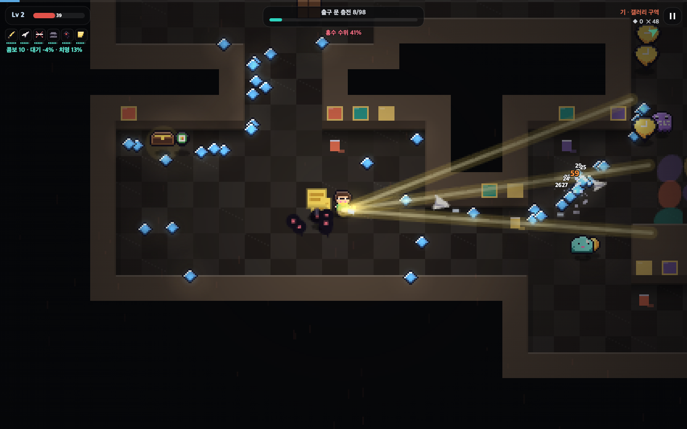
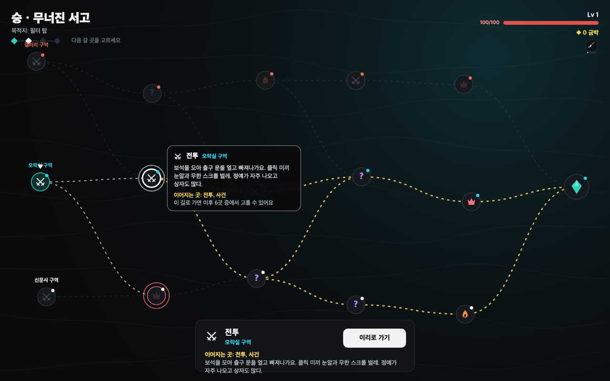
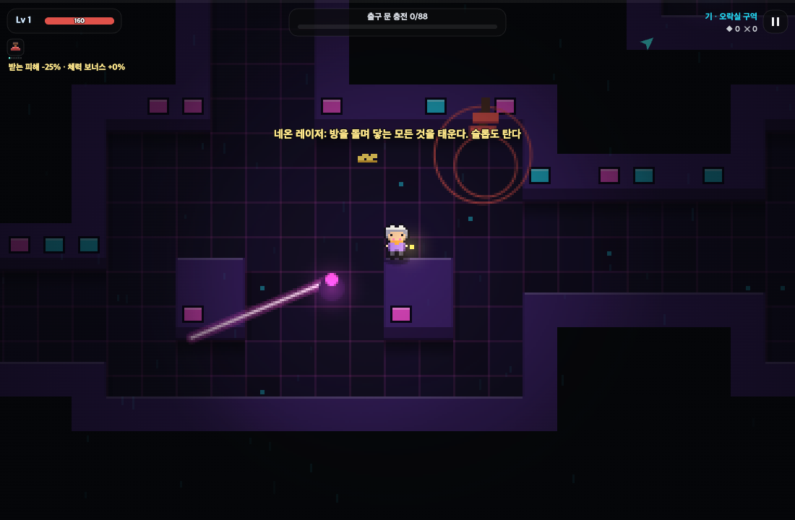

# 슬롭폴 Slopfall

보석 색인을 들고 필터 탑까지 가는 4막 도트 액션 게임이에요. [Slop](https://slop.ai.kr)에 올린 게임이고, Claude와 함께 만들었어요.

A four-act pixel action game: carry the Seed Index to the Filter Tower. Made with Claude and posted on [Slop](https://slop.ai.kr).

**플레이 / Play:** [한국어](https://slop.ai.kr/p/387dabe2-ef5a-4e45-b4b7-f4eeb65c73d0) · [English](https://slop.ai.kr/p/e32b2c2f-b368-4015-b00a-bab683897509)
— 또는 이 저장소의 `slopfall.html`(한국어) / `slopfall.en.html`(English)을 브라우저로 바로 열어도 돼요. Or just open either file in a browser.



## 어떤 게임인가요

- **4막 여정(기·승·전·결):** 막마다 갈림길 지도가 새로 만들어지고, 전투·정예·쉼터·사건·기록 보관함 중에서 길을 골라요. 지점에 마우스를 올리면 그 길이 어디로 이어지는지 보여요. 3막의 선택에 따라 마지막 싸움과 엔딩(2개)이 달라져요.
- **큐레이터 셋, 겹치지 않는 기술 6종씩(총 18종):**
  - 미나: 체력이 낮을수록 세지는 근접형 (붓 · 가위 · 커터칼 · 먹물 자국 · 빨간 펜 원 · 테이프)
  - 도윤: 맞지 않으면 콤보로 빨라지는 조준·설치형 (형광펜 · 종이비행기 · 취소선 · 스테이플러 · 쉼표 지뢰 · 포스트잇)
  - 옥 할머니: 단단하고 체력이 클수록 세지는 버티기형 (감정 도장 · 지우개 · 돋보기 햇빛 · 주판알 · 찻주전자 · 종)
- **스킬 트리:** 기술마다 진화와 두 갈래 3단계 트리가 있어요. 그 기술로 많이 지울수록 상위 단계가 레벨 업 선택지에 자주 나와요. 한 기술에서 3단계는 한 갈래만 찍을 수 있어요.
- **지역별 기믹:** 쓰러지는 광고판, 액자 통로, 네온 레이저와 슬롯머신, 윤전기 벨트, 거울 조각, 방화벽. 어디서나 부술 상자, 연쇄 폭발 통, 제단, 봉인된 보관함도 있어요.
- **홍수:** 출구가 열린 뒤에도 머물면 홍수가 차올라요. 홍수 물결의 슬롭은 아무것도 남기지 않으니, 버티기보다 앞으로 나아가는 게 이득이에요.



## 조작 / Controls

- 이동 WASD·방향키 / Move WASD or arrows
- 대시 Space·Shift (잠깐 무적) / Dash Space or Shift (brief invincibility)
- 일시정지 Esc / Pause Esc
- 휴대폰: 화면을 끌어서 이동, 오른쪽 아래 버튼으로 대시 / Phone: drag to move, tap the bottom-right button to dash

## 구조 / How it is built

외부 라이브러리나 이미지 파일 없이 HTML 한 파일로 돌아가요. 그림은 모두 코드 안의 도트 문자열로, 소리는 Web Audio로 만들어요.
One self-contained HTML file: no libraries, no image or sound files. Sprites are pixel strings in the code; sound is synthesized with Web Audio.

```
src/            게임 코드 (번호 순서대로 이어 붙여요) / game source, concatenated in order
  10-text.js    한국어·영어 문구 / Korean and English text
  12-skilltext  새 기술 문구 / text for the curator-only skills
  20-core.js    캔버스, 입력, 소리 / canvas, input, sound
  30-sprites.js 도트 그림 / pixel art
  40-data.js    무기·적·지역·막·큐레이터 데이터 / data
  45-map.js     갈림길 지도 / the branching map
  50-world.js   구역 생성, 피해, 성장 / areas, damage, growth
  55-foes.js    슬롭과 보스 / slop and bosses
  60-weapons.js 기본 무기 6종 / the first six weapons
  62-skills.js  큐레이터 전용 기술 12종 / the twelve curator-only skills
  63-gimmicks.js 지역별 기믹 / regional gimmicks
  70-render.js  그리기와 조명 / drawing and light
  71-hud.js     HUD, 대화, 카드 / HUD, dialogue, cards
  75-scenes.js  여정 흐름, 쉼터, 상점, 사건 / journey flow and scenes
  80-game.js    상태와 메인 루프 / states and main loop
build.mjs       src를 이어 붙여 slopfall.html(한국어)과 slopfall.en.html(영어)을 만들어요
```

```bash
node build.mjs
```


